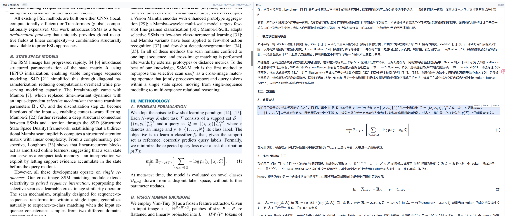

<div align="center">

# 📖 Diptych

> *Two panels, one document — read the original and the translation side by side, layout intact.*

[](LICENSE)
[](https://www.rust-lang.org)
[](https://github.com/wx-rdc/diptych/actions)
[](https://github.com/wx-rdc/diptych/releases)
[](https://mineru.net)
[](#-translation-pipeline)
[](http://x.wx-rdc.top)

**Diptych（双联画）** 是一款**版式保留、左右对照**的 PDF / DOCX 双语翻译阅读器：
公式、表格、算法块与参考文献原样呈现，段落级同步高亮，由大模型驱动翻译。

*A layout-preserving, bilingual parallel reader & translator for PDF/DOCX —
formulas, tables, algorithm blocks and references rendered intact, powered by LLMs.*

<!-- 📸 主截图：双栏对照全景（建议 1600×900，取 b2 论文第 2 页场景） -->
<p align="center">
  
</p>
<p align="center">
  <sub>左：原文原始渲染 &nbsp;·&nbsp; 右：译文 &nbsp;·&nbsp; 块级同步高亮 &nbsp;·&nbsp; 公式 / 表格 / 算法块保留</sub>
</p>

</div>

## 🚀 Quick Start

**前置依赖**：Rust ≥ 1.78（含 Cargo）、Node.js ≥ 20 与 [pnpm](https://pnpm.io) ≥ 9。

```bash
# 1. 配置 LLM 密钥（DeepSeek 或任意 OpenAI-compatible 端点）
cp .env.example .env.local        # 填入 DEEPSEEK_API_KEY（MinerU 可选）

# 2. 构建前端（产物在 app/dist，由后端直接托管）
cd app && pnpm install && pnpm build && cd ..

# 3. 启动服务并打开 http://127.0.0.1:39321
cargo run -p geminus-server
```

上传 PDF / DOCX 即可在左栏阅读原文、右栏获得版式保留的译文；
登录与匿名配额等行为由 `GEMINUS_*` 环境变量控制，见 `.env.example` 内注释。

## 📄 License & Trademark / 许可与商标

### 社区版（本仓库）— Apache License 2.0

本仓库为 **Diptych Community Edition**，以 [Apache License 2.0](LICENSE) 开源（SPDX: `Apache-2.0`）。

**你可以**：免费商用、修改、分发、私有化部署、**自营翻译/阅读服务（含收费）**，无需付费或事先授权。
**你需要**：保留版权与许可声明、对修改作出说明、接受"按现状"无担保。
**专利授权**：Apache-2.0 含明示专利授权条款，贡献者自动授予实施其贡献所需的专利许可。

### 商业版（Diptych Pro）— 单独商业许可

以下组件**不包含**在本开源仓库中，属闭源商业版，需单独商业授权：

- **TwinDoc 版式保留引擎**（overlay 排版、CJK 字体嵌入、autofit 溢出处理）
- **多租户 / 配额 / 计费 / 账号运营组件**
- **云端缓存与术语表同步服务**

完整开源/商业边界见 [OPEN_CORE.md](OPEN_CORE.md)。如需商业授权、OEM 或私有化交付：
📧 licensing@wx-rdc.top

### 第三方组件

依赖的第三方开源组件各自适用其许可（MIT / Apache-2.0 / SIL OFL 等），
完整归属见 [NOTICE](NOTICE) 与 [docs/THIRD_PARTY.md](docs/THIRD_PARTY.md)。
嵌入 PDF 所用 Noto Sans SC 字体遵循 SIL OFL 1.1（允许嵌入，不得单独售卖字体文件）。

### 商标

"Diptych" 名称与标识是 Wuxi RDC Tech 的商标。
**Apache-2.0 不授予任何商标权**（见 Apache-2.0 第 6 条）。
开源代码 ≠ 授权品牌：你可以自由使用代码，但不得以 "Diptych" 名义运营服务或产品，
除非遵守 [TRADEMARK.md](TRADEMARK.md)。

### 贡献

提交 Issue / PR 即视为同意以 Apache-2.0（含专利授权）双许可贡献你的代码。
重大功能贡献需签署 CLA（贡献者许可协议），以保障项目未来许可调整的灵活性。
