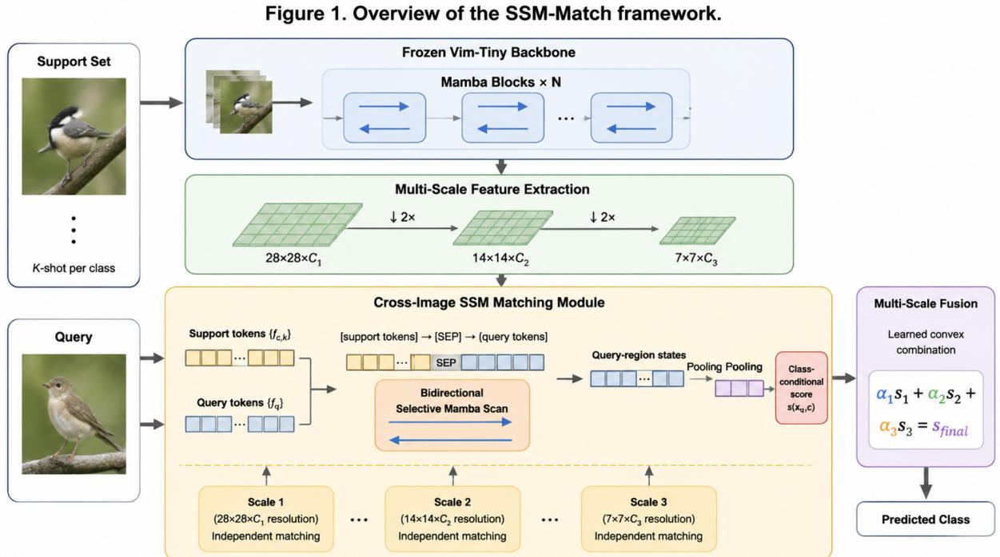
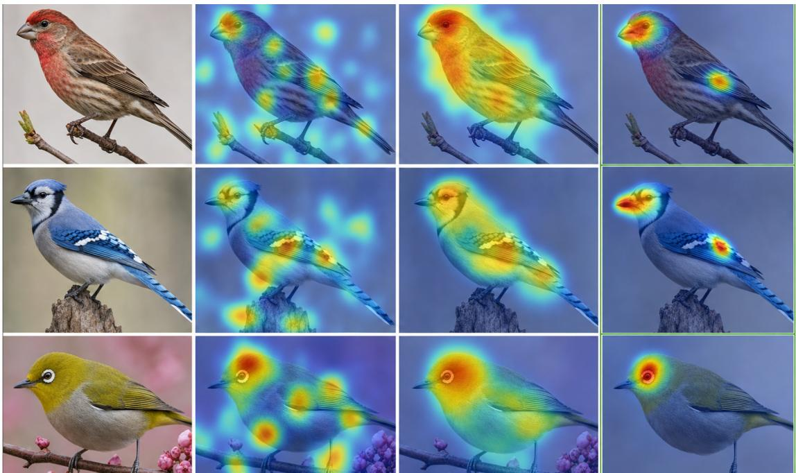
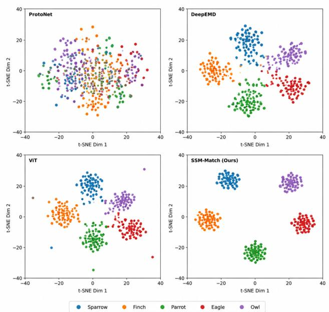

Date of publication xxxx 00, 0000, date of current version July 24, 2026. Digital Object Identifier 10.1109/ACCESS.2026.XXXXXXX

# SSM-Match: Bridging State Space Models and Metric Learning for Few-Shot Fine-Grained Image Classification

HONGYU ZHU1, GUI LIU2, and RONG LI1

1School of IoT Engineering, Wuxi Taihu University, Wuxi 214064, China, and also with the Provincial Key (Construction) Laboratory of Intelligent Internet of Things Technology and Applications in Universities, Wuxi 214064, China. (e-mail: zhuhy163@163.com) 2Jiangnan Institute of Computing Technology, Wuxi 214083, China.

Corresponding author: HongYu Zhu (e-mail: zhuhy163@163.com).

Date of current version July 24, 2026. This work was supported by the Natural Science Foundation of Jiangsu Higher Education Institutions of China under Grant XXXXXX

ABSTRACT Few-shot fine-grained image classification requires distinguishing visually similar categories from only 1–5 labeled examples per class, a regime in which convolutional neural networks and vision transformers face inherent limitations in efficiency or receptive-field coverage. State space models (SSMs), particularly Mamba with its input-dependent selective mechanism, offer global receptive fields with linear complexity. However, existing vision SSMs process single images in isolation, and recent attempts to bring SSMs to few-shot learning employ them only as frozen backbones or prototype enhancers, leaving the scan mechanism itself unexplored as a relational operator. We propose SSM-Match, which recasts the selective scan as a cross-image matching operator: for each class, support and query patch tokens are concatenated with a class-conditional prior token and per-image separators, and a bidirectional selective scan yields support-conditioned query evidence and query-conditioned support summaries, fused by input-dependent direction and evidence gates. Independent matching modules at three token-grid resolutions capture both coarse, semantics and fine-grained detail On CUB-200-2011 5-way 5-shot, SSM-Match with a frozen Vim-Tiny backbone reaches 84.72%, and it consistently improves over a cosine-similarity classifier on the same features on miniImageNet, Stanford Cars, and cross-domain CIFAR-FS. With linear O(KL) matching complexity, training completes on a single consumer GPU in approximately three hours, bringing relational reasoning with state space models to data-efficient visual recognition.

INDEX TERMS few-shot learning, state space model, fine-grained image classification, metric learning.

## I. INTRODUCTION

F EW-SHOT image classification—recognizing novel cat- egories from 1–5 examples—remains a fundamental challenge in computer vision. The difficulty intensifies in fine-grained settings such as distinguishing among 200 bird species in CUB-200-2011 [1] or 196 car models in Stanford Cars [2], where inter-class differences are subtle and easily confounded by pose, lighting, and background variation. In such regimes, a model must simultaneously capture global context to understand what distinguishes two similar categories and fine-grained local detail to identify the specific discriminative features, all while resisting overfitting given extremely limited supervision.

Existing solutions fall predominantly into two architectural families, each with a fundamental trade-off. Convolutional Neural Networks (CNNs) [3] offer parameter efficiency and an inductive bias toward local patterns, but their limited receptive fields struggle to capture long-range dependencies without deep stacking of layers. Vision Transformers (ViTs) [4] address this limitation via global self-attention, enabling every patch to attend to every other patch. However, this comes at the prohibitive cost of $O ( N ^ { 2 } )$ complexity with respect to patch count N. For high-resolution fine-grained images and multi-image episodic training, where the effective sequence length grows to N × K support–query pairs, this quadratic scaling becomes a severe practical bottleneck [5].

State Space Models (SSMs) have recently emerged as a compelling third paradigm that fundamentally resolves this trade-off. The structured state space model S4 [6] demonstrated that carefully parameterized linear systems can match Transformers on long-range modeling tasks while maintaining O(N) complexity. Mamba [7] advanced this further with a critical innovation: input-dependent selectivity—the state transition parameters adapt dynamically based on each input token, enabling the model to selectively retain relevant information and discard irrelevant content. This selectivity aligns remarkably well with the core requirement of fewshot classification: learning, from very few examples, which features to attend to and which to ignore.

The vision community has rapidly adopted SSMs, with architectures such as Vim [8], VMamba [9], and Local-Mamba [10] achieving competitive ImageNet accuracy with fewer parameters than ViTs. Comprehensive surveys [11], [12] catalog these developments and independently identify few-shot learning as a notably under-explored frontier. However, a crucial gap remains: all existing vision SSMs process single images in isolation. No prior method has explored whether the selective scan mechanism can be repurposed for cross-image relational reasoning—jointly processing support and query images within a unified state space to learn imageto-class similarity in a fully differentiable manner. This capability is the essence of metric-based few-shot learning, and its absence from the SSM literature represents a significant missed opportunity.

In this paper, we propose SSM-Match, a framework that recasts the selective scan as a relational operator for fewshot metric learning. Whereas existing SSM-based few-shot approaches use Mamba architectures as frozen feature extractors or prototype enhancers [28], [29], our core insight concerns the scan mechanism itself: a bidirectional Mamba scan over a concatenated support–query token sequence implicitly constructs structured, input-dependent cross-attention maps between support patches and query patches, in line with the state space duality between selective SSMs and masked attention [22]. Crucially, this mechanism operates at O(KL) linear complexity rather than the $O ( K ^ { 2 } L ^ { 2 } )$ ) quadratic cost of explicit cross-attention, where K is the number of support images and L is the sequence length, enabling practical deployment on consumer hardware.

## Our specific contributions are as follows:

1) We recast Mamba’s selective scan as a cross-image matching operator, to our knowledge the first use of the scan itself—rather than an SSM backbone or its pooled features—as a learnable relational mechanism between support and query images. The operator concatenates support and query tokens with a classconditional prior token and per-image separators; bidirectional scanning yields support-conditioned query evidence and query-conditioned support summaries, fused by input-dependent direction and evidence gates into a context-dependent similarity score.

2) We construct a multi-scale matching pyramid over three parameter-free token grids derived from the frozen Vim-Tiny backbone, performing matching simultaneously at $2 8 \times 2 8 .$ , 14 × 14, and 7 × 7 resolutions to capture both coarse semantic and fine-grained discriminative cues.

3) We give a complexity and duality-grounded analysis of the operator: matching costs O(KL) versus $O ( K ^ { 2 } L ^ { 2 } )$ for explicit cross-attention, and the dual-readout design admits an interpretation as structured masked attention via the SSM–attention duality.

4) Through extensive experiments on miniImageNet, CUB-200-2011, Stanford Cars, and cross-domain CIFAR-FS—with equal-protocol backbones, factorized ablations, statistical testing, and measured efficiency profiles—we show that cross-image selective scanning provides consistent gains over fixed metrics on identical features, with particularly strong results on fine-grained tasks.

## II. RELATED WORK

## A. FEW-SHOT LEARNING

Few-shot learning (FSL) methods broadly divide into optimization-based and metric-based paradigms. Optimizationbased approaches, exemplified by MAML [13], learn model initializations that can rapidly adapt to new tasks through few gradient steps. While conceptually elegant, these methods incur the computational cost of second-order optimization and remain susceptible to overfitting in extremely low-data regimes.

Metric-based methods [14], [15], [16] have become the dominant paradigm due to their simplicity and effectiveness. These approaches learn an embedding space where classification reduces to nearest-neighbor search: Prototypical Networks [15] average support features into class prototypes; Matching Networks [14] employ attention-weighted aggregation; Relation Networks [16] learn a deep nonlinear comparator. More recent advances include DN4 [17], which performs image-to-class matching via local descriptor alignment; DeepEMD [18], which employs a differentiable Earth Mover’s Distance for optimal transport-based matching; and FRN [19], which reconstructs query features from support-set bases.

For few-shot fine-grained classification specifically, recent work guides matching with multi-level convolutional features. The bi-focus cosine complement network combines global and local branches with a cosine complement term to sharpen support–query similarity [26], and MAGNET propagates multi-level feature guidance so that high-level semantics steer low-level detail matching [27]. Both compute similarity with predefined (cosine-type) measures over separately encoded images. SSM-Match differs in the matching mechanism itself: support and query tokens are concatenated and processed within one selective scan, so similarity is computed by input-dependent state dynamics rather than a fixed distance, and every query patch can interact with every support patch at linear cost.

A critical methodological concern, raised by Chen et al. [20] and Tian et al. [5], is that reported FSL gains often stem from improved training recipes rather than architectural novelty. We directly address this in our evaluation by using identical training recipes across all compared methods, isolating the contribution of architectural choice.

All existing FSL methods are built on either CNNs (local, computationally efficient) or Transformers (global, computationally expensive). Our work introduces SSMs as a third architectural pathway that uniquely provides global receptive fields at linear complexity—a combination structurally unavailable to prior FSL approaches.

## B. STATE SPACE MODELS

The SSM lineage has progressed rapidly. S4 [6] introduced structured parameterization of the state matrix A using HiPPO initialization, enabling stable long-range sequence modeling. S4D [21] simplified this through diagonal parameterization, reducing computational overhead while preserving modeling capacity. The breakthrough came with Mamba [7], which replaced time-invariant dynamics with an input-dependent selective mechanism: the state transition parameters $\mathbf { B } _ { t } , \mathbf { C } _ { t } .$ , and the discretization step $\Delta _ { t }$ become functions of the input $u _ { t }$ , enabling context-aware filtering. Mamba-2 [22] further revealed a deep structural connection between SSMs and attention through the SSD (Structured State Space Duality) framework, establishing that a bidirectional Mamba scan implicitly computes a structured attention matrix with linear complexity. From a complementary perspective, Longhorn [33] shows that linear-recurrent blocks act as amortized online learners, suggesting that a scan state can serve as a compact task memory—an interpretation we exploit by letting support evidence accumulate in the state before the query readout.

However, all these developments operate on single sequences. Our cross-image SSM matching module extends selectivity to paired sequence interaction, repurposing the selective scan as a learnable cross-image similarity operator. The scan mechanism, originally designed for sequence-tosequence transformation within a single input, generalizes naturally to sequence-to-class matching when the input sequence concatenates samples from two different domains (support and query).

## C. VISION STATE SPACE MODELS

Several architectures have adapted Mamba for visual tasks. Vim [8] introduces bidirectional scanning with position embedding for image classification, achieving ViT-competitive accuracy with fewer parameters. VMamba [9] proposes a cross-scan with four-directional scanning to capture 2D spatial structure more effectively. LocalMamba [10] decomposes images into local windows with scanning within each window, improving locality. For segmentation, SegMamba [23] adapts the architecture for dense prediction. A comprehensive survey [12] catalogs these developments and explicitly identifies few-shot learning as an under-explored application area.

Critically, all of these architectures process single images in isolation. A growing body of work subsequently applies SSMs to low-shot regimes, but always in a backbone or feature-enhancement role: Misra et al. [28] study the low-shot transferability of frozen V-Mamba features; VMAPN couples a Vision Mamba encoder with enhanced prototype aggregation [29]; a Mamba–wavelet multi-scale model targets fewshot fine-grained classification [30]; Mamba-FSCIL adapts selective SSMs to few-shot class-incremental learning [31]; and Mamba variants have been applied to few-shot action recognition [32] and few-shot detection/segmentation [34], [35]. In all of these methods the scan remains confined to one input sequence, and cross-image matching is performed afterwards by external prototypes or distance metrics. To the best of our knowledge, SSM-Match is the first method to repurpose the selective scan itself as a cross-image matching operator that jointly processes support and query tokens within a single state space, moving from single-sequence modeling to multi-sequence relational reasoning.

## III. METHODOLOGY

## A. PROBLEM FORMULATION

We adopt the episodic few-shot learning paradigm [14], [15]. Each N-way K-shot task $\tau$ consists of a support set $s =$ $\{ ( x _ { i } , y _ { i } ) \} _ { i = 1 } ^ { N \times \mathbf { \bar { K } } }$ and a query set ${ \mathcal { Q } } = \{ ( x _ { j } , y _ { j } ) \} _ { j = 1 } ^ { \perp \times M }$ , where x denotes an image and $y \in \{ 1 , \ldots , N \}$ its class label. The objective is to learn a classifier $f _ { \theta }$ that, given the support set as reference, correctly predicts query labels. Formally, we minimize the expected query loss over a task distribution $p ( \mathcal { T } )$

$$
\min _ {\theta} \mathbb {E} _ {\mathcal {T} \sim p (\mathcal {T})} \left[ \sum_ {(x _ {j}, y _ {j}) \in \mathcal {Q}} - \log p _ {\theta} (y _ {j} \mid x _ {j}, \mathcal {S}) \right].\tag{1}
$$

At meta-test time, the model is evaluated on novel classes $\mathcal { D } _ { \mathrm { n o v e l } }$ drawn from a disjoint label space, without further parameter updates.

## B. VISION MAMBA BACKBONE

We employ Vim-Tiny [8] as a frozen feature extractor. Given an input image $x ~ \in ~ \mathbb { R } ^ { H \times W \times 3 }$ , patches of size $P \times P$ are flattened and linearly projected into $L = H W / P ^ { 2 }$ tokens of dimension D, forming a sequence $\textbf { u } \in \mathbb { R } ^ { L \times \mathrm { \partial D } }$ . A stack of bidirectional Mamba blocks processes this sequence, where each block applies forward and backward selective scans independently and averages their outputs.

The core of a Mamba block is a selective state space model, governed by a continuous-time linear system discretized via zero-order hold:

$$
\mathbf {h} _ {t} = \overline {{\mathbf {A}}} _ {t} \mathbf {h} _ {t - 1} + \overline {{\mathbf {B}}} _ {t} u _ {t}, \quad y _ {t} = \mathbf {C} _ {t} \mathbf {h} _ {t},\tag{2}
$$

where $\overline { { \mathbf { A } } } _ { t } = \exp ( \Delta _ { t } \mathbf { A } )$ and $\overline { { \mathbf { B } } } _ { t } = ( \Delta _ { t } \mathbf { A } ) ^ { - 1 } ( \exp ( \Delta _ { t } \mathbf { A } ) -$ $\mathbf { I } ) \cdot \Delta _ { t } \mathbf { B } _ { t }$ . The parameters $\mathbf { B } _ { t } = s _ { B } ( u _ { t } ) , \mathbf { C } _ { t } = s _ { C } ( u _ { t } )$ , and $\Delta _ { t } = \tau ( \mathrm { P a r a m e t e r } + s _ { \Delta } ( u _ { t } ) )$ are all input-dependent linear projections of the current token, with $\mathbf { A } \in \mathbb { R } ^ { \hat { N } _ { s } \times N _ { s } }$ being the only time-invariant parameter.

Vim-Tiny is an isotropic, single-scale architecture: all 24 bidirectional Mamba blocks operate on ${ \textbf { a } } 1 4 \times 1 4$ token grid of width $D = 1 9 2 ( { \mathrm { a ~ } } 2 2 4 \times 2 2 4 { \mathrm { ~ } }$ image with $1 6 \times 1 6$ patches yields $L ~ = ~ 1 9 6$ patch tokens, with a class token inserted at the middle sequence position). It therefore does not natively provide hierarchical feature maps. We instead derive three token grids from the final-layer normalized patch tokens $\mathbf { F } ^ { ( 2 ) } \in \bar { \mathbb { R } } ^ { 1 9 6 \times 1 9 2 }$ through deterministic channel– space rearrangements: $\mathbf { F } ^ { ( 1 ) } ~ \in ~ \overline { { \mathbb { R } } } ^ { 7 8 4 \times 4 8 }$ via pixel-shuffle (space-to-channel upsampling, $1 4 \times 1 4  2 8 \times 2 8 )$ , which preserves fine spatial detail at a reduced channel width, and $\mathbf { \bar { F } ^ { ( 3 ) } } \in \mathbb { R } ^ { 4 9 \times 7 6 8 ^ { \circ } }$ via pixel-unshuffle (channel-to-space downsampling, $1 4 { \times } 1 4  7 { \times } 7 )$ , which aggregates neighboring tokens into wider, more semantic tokens. Both rearrangements are parameter-free, so no backbone capacity is altered and the frozen-backbone design is preserved; all learnable adaptation resides in the per-scale input projections of the matching heads $( 4 8 / 1 9 2 / 7 6 8 \ \to \ 1 6 0 / 2 5 6 / 3 2 0$ , Section III-C). The complete layer-level architecture and all hyperparameters are given in the supplementary material. The frozen backbone requires zero gradient computation and serves as a natural regularizer against overfitting in the few-shot regime.

  
FIGURE 1. Overview of the SSM-Match framework. A frozen Vim-Tiny backbone extracts features at three derived token grids from support and query images. The cross-image SSM matching module concatenates a class-conditional prior token, support patch tokens (each followed by a learnable [SEP] separator), and query patch tokens, processes them through a bidirectional selective Mamba scan, and derives class-conditional matching scores from dual directional readouts. Multi-scale scores are fused via a learned convex combination for final classification.

## C. CROSS-IMAGE SSM MATCHING MODULE

The central innovation of SSM-Match is a matching module that replaces conventional pairwise distance functions (Euclidean, cosine, learned metric) with a joint selective scan across query and support features. The scan implements structured, masked attention rather than all-pair uniform attention: by the SSM–attention duality [22], the causal scan at query position t computes a weighted aggregation of all earlier positions $t ^ { \prime } \leq t$ whose decay weights form a semiseparable matrix and whose content weights $\mathbf { C } _ { t } \mathbf { B } _ { t ^ { \prime } }$ are input-dependent. Two properties follow. First, because the joint sequence places all support tokens before the query tokens, the forward scan at every query position attends to every support patch—a complete support-to-query interaction at $O ( K L )$ cost. Second, scanning the sequence in reverse (queries first, supports afterwards) yields the complementary interaction: support positions that aggregate query context. The two readouts below make both directions explicit.

## 1) Joint Sequence Construction

Let $\mathbf { F } _ { c , k } ~ \in ~ \mathbb { R } ^ { L \times C }$ denote the feature map of the k-th support sample of class $^ { c , }$ flattened into L patch tokens, and $\mathbf { \bar { F } } _ { q } ~ \in ~ \mathbb { R } ^ { \bar { L } \times C }$ that of the query image. For each class $^ { c , }$ we construct a joint sequence consisting of a class-conditional prior token, all support tokens each followed by a learnable [SEP] separator, and all query tokens:

$$
\begin{array}{c} \mathbf {Z} _ {c} = [   \mathbf {p} _ {c};   \mathbf {f} _ {c, 1} ^ {(1)}, \ldots , \mathbf {f} _ {c, 1} ^ {(L)},   [   \text {SEP} ];   \ldots ; \\ \mathbf {f} _ {c, K} ^ {(1)}, \ldots , \mathbf {f} _ {c, K} ^ {(L)},   [   \text {SEP} ];   \mathbf {f} _ {q} ^ {(1)}, \ldots , \mathbf {f} _ {q} ^ {(L)} ] \in \mathbb {R} ^ {T \times C}, \end{array}\tag{3}
$$

where $T = 1 + K ( L + 1 ) + L$ is the total sequence length. The prior token $\mathbf { p } _ { c } = \mathbf { W } _ { p } \bar { \mathbf { f } } _ { c }$ linearly maps the pooled supportset mean $\bar { \mathbf { f } } _ { c }$ and acts as a class-conditional state initialization: the scan enters the support region already holding an implicit class prototype, rather than starting from a zero state. The [SEP] tokens, initialized randomly and learned during training, mark image boundaries so that the selective mechanism can attribute evidence to individual support images.

## 2) Bidirectional Selective Scan and Dual Readouts

The concatenated sequence $\mathbf { Z } _ { c }$ passes through a bidirectional Mamba matching layer (the same Mamba weights applied to $\mathbf { Z } _ { c }$ and to $\mathbf { Z } _ { c }$ reversed). Because a selective scan is causal, the two scan directions admit two complementary readouts:

• Forward (support → query). The forward hidden state at query position $\begin{array} { r } { t , \mathbf { h } _ { t } ^ { \left( f \right) } = \sum _ { t ^ { \prime } \leq t } \overline { { \mathbf { B } } } _ { t ^ { \prime } } \left( \prod _ { s = t ^ { \prime } + 1 } ^ { t } \overline { { \mathbf { A } } } _ { s } \right) u _ { t ^ { \prime } } } \end{array}$ accumulates all support tokens and prior token before any query token. Pooling over the query region yields a support-conditioned query representation

$$
\mathbf {m} _ {c} ^ {(f)} (x _ {q}) = \frac {1}{L} \sum_ {t = T - L + 1} ^ {T} \mathbf {h} _ {t} ^ {(f)} \in \mathbb {R} ^ {C},\tag{4}
$$

i.e., the query evidence filtered through the full support context.

• Backward (query → support). In the reversed sequence the query block is scanned first, so the states at the support positions $( t \geq L + 1 )$ encode the query context; pooling over that region yields a query-conditioned support summary

$$
\mathbf {m} _ {c} ^ {(b)} (x _ {q}) = \frac {1}{1 + K (L + 1)} \sum_ {t = L + 1} ^ {T} \mathbf {h} _ {t} ^ {(b)} \in \mathbb {R} ^ {C}.\tag{5}
$$

The two vectors carry asymmetric semantics—‘‘what does the support evidence say about this query’’ versus ‘‘how does this query recalibrate the support evidence’’—so averaging them is suboptimal. We fuse them with an input-dependent direction gate, then rescale the fused evidence with an evidence gate that modulates support dimensions according to the current query–support pair:

$$
[ \lambda_ {f}, \lambda_ {b} ] = \mathrm{softmax} \big (\mathbf {W} _ {d} [ \mathbf {m} _ {c} ^ {(f)}; \mathbf {m} _ {c} ^ {(b)} ] \big),\tag{6}
$$

$$
\mathbf {m} _ {c} ^ {\star} = \lambda_ {f} \mathbf {m} _ {c} ^ {(f)} + \lambda_ {b} \mathbf {m} _ {c} ^ {(b)}, \quad \tilde {\mathbf {m}} _ {c} = \sigma \left(\mathbf {W} _ {g} [ \mathbf {m} _ {c} ^ {\star}; \bar {\mathbf {f}} _ {c} ]\right) \odot \mathbf {m} _ {c} ^ {\star},\tag{7}
$$

where $\mathbf { W } _ { d } \in \mathbb { R } ^ { 2 \times 2 C } , \mathbf { W } _ { g } \in \mathbb { R } ^ { C \times 2 C } , \sigma ( \cdot )$ is the element-wise sigmoid, and $\bar { \mathbf { f } } _ { c }$ is the pooled support mean.

## 3) Matching Score

A linear head maps the gated representation to a raw matching score for class c:

$$
s (x _ {q}, c) = \mathbf {W} _ {o} \tilde {\mathbf {m}} _ {c} + b _ {o} \in \mathbb {R}.\tag{8}
$$

We deliberately do not squash s through a sigmoid: class scores are compared through the softmax in the training objective (Eq. 10), and a sigmoid pre-activation would compress all scores into [0, 1], capping the maximum class probability of an N-way task at $e ^ { s _ { \mathrm { m a x } } } / ( e ^ { s _ { \mathrm { m a x } } } + N - 1 )$ and distorting the softmax geometry. An ablation with a sigmoid head is reported in Section IV-C. At inference, the predicted class is $\hat { y } _ { q } = \arg \operatorname* { m a x } _ { c } s ( x _ { q } , c )$

## 4) Complexity Analysis

For a support set with K images per class and L patch tokens per image, explicit cross-attention computing pairwise attention between all $( K + 1 ) L$ tokens requires $O ( ( K + 1 ) ^ { 2 } L ^ { 2 } )$ operations and $O ( ( K + 1 ) ^ { 2 } L ^ { 2 } )$ memory to materialize the attention matrix. In contrast, the Mamba scan processes each token sequentially with O(1) per-token state updates, giving a total complexity of ${ \cal O } ( ( K + 1 ) L \cdot N _ { s } ^ { 2 } ) = { \cal O } ( K L )$ for a fixed state dimension $N _ { s } \ \ll \ L$ , with $O ( K L \cdot N _ { s } )$ memory for accumulated hidden states. In practice, for a 5-way 1-shot setting with $L = 1 9 6$ patches (14 × 14 grid) at a single scale, the measured memory and latency gap between the selective scan and a matched-capacity explicit cross-attention head is reported in Table 7. This gap widens with increased K and L, making the multi-scale pyramid design—three simultaneous matching operations at different resolutions—practical with selective scanning but prohibitively expensive with attention.

## D. MULTI-SCALE SSM FEATURE PYRAMID

Fine-grained discrimination requires cues at multiple spatial resolutions. Coarse features capture holistic shape and texture patterns, while fine features encode subtle part-level details. We instantiate an independent cross-image SSM matching module $\phi _ { r }$ at each of the three token grids $( 2 8 \times 2 8 , 1 4 \times 1 4$ $7 \times 7 )$ . The three modules share an identical architecture but hold independent parameters, each with its own input projection (Section III-C).

The final matching score is a learned convex combination:

$$
s _ {\text { final }} (x _ {q}, c) = \sum_ {r = 1} ^ {3} \alpha_ {r} s ^ {(r)} (x _ {q}, c), \quad \sum_ {r = 1} ^ {3} \alpha_ {r} = 1, \alpha_ {r} \geq 0,\tag{9}
$$

where $\alpha _ { r } = \mathrm { s o f t m a x } ( \mathbf { w } _ { r } )$ are parameterized via learnable logits $\mathbf { w } \in \mathbb { R } ^ { 3 }$ . The convex combination constraint ensures stable training and interpretable scale-importance weights. Because each SSM matching module operates at $O ( K L _ { r } )$ complexity where $L _ { r }$ decreases with coarser resolution $( L _ { 1 } =$ 784, $L _ { 2 } ~ = ~ 1 9 6 , L _ { 3 } ~ = ~ 4 9 )$ , the total cost of multi-scale matching is approximately $7 8 4 + 1 9 6 + 4 9 = 1 0 2 9$ effective operations versus 784 for single-scale matching at the finest resolution—a modest 31% overhead for tripling the representational capacity.

## E. TRAINING OBJECTIVE

We train SSM-Match end-to-end using episodic sampling from the base class set $\mathcal { D } _ { \mathrm { b a s e } }$ . For each episode, the classconditional matching scores are normalized via softmax to obtain a probability distribution over the N classes:

$$
p (\hat {y} = c \mid x _ {q}, \mathcal {S}) = \frac {\exp (s (x _ {q} , c) / \tau)}{\sum_ {c ^ {\prime} = 1} ^ {N} \exp (s (x _ {q} , c ^ {\prime}) / \tau)},\tag{10}
$$

where τ is a temperature parameter (set to 1.0 by default). The primary loss is cross-entropy over all query examples in the

episode:

$$
\mathcal {L} _ {\mathrm{CE}} = - \frac {1}{N M} \sum_ {j = 1} ^ {N M} \log p (\hat {y} = y _ {j} \mid x _ {j}, \mathcal {S}).\tag{11}
$$

We optionally incorporate a contrastive auxiliary loss in the InfoNCE form. For query image $x _ { j } .$ , let $\tilde { \mathbf { q } } _ { c } ( x _ { j } ) = \tilde { \mathbf { m } } _ { c } ( x _ { j } )$ denote its fused representation under the class-c context (Eq. 7), and let $\begin{array} { r } { \tilde { \mathbf { q } } _ { c } = \frac { 1 } { M } \sum _ { j } \tilde { \mathbf { q } } _ { c } ( x _ { j } ) } \end{array}$ be the query-context representation averaged over the episode’s queries. The loss aligns each class’s query-context representation with its own class prior $\tilde { \mathbf { p } } _ { c }$ (the normalized pooled support embedding through the input projection) against the other N − 1 class priors:

$$
\mathcal {L} _ {\text {con}} = - \frac {1}{N} \sum_ {c = 1} ^ {N} \log \frac {\exp \left(\operatorname{sim} \left(\tilde {\mathbf {q}} _ {c} , \tilde {\mathbf {p}} _ {c}\right) / \tau_ {c}\right)}{\sum_ {c ^ {\prime} = 1} ^ {N} \exp \left(\operatorname{sim} \left(\tilde {\mathbf {q}} _ {c} , \tilde {\mathbf {p}} _ {c ^ {\prime}}\right) / \tau_ {c}\right)},\tag{12}
$$

where sim $( \cdot , \cdot )$ is the cosine similarity and $\tau _ { c } ~ = ~ 0 . 2 .$ . The positive pair is query-context representation vs. class prior rather than a pair of same-class support embeddings, so the loss is well-defined even in the 1-shot setting (K=1), where each class contributes exactly one prior and the N−1 priors of the remaining classes serve as negatives. Intuitively, it encourages the scan’s fused evidence to be class-separable before the score head. The total loss is ${ \mathcal { L } } = { \mathcal { L } } _ { \mathrm { C E } } + \lambda { \mathcal { L } } _ { \mathrm { c o n } }$ with $\lambda = 0 . 1$

## IV. EXPERIMENTS

## A. EXPERIMENTAL SETUP

Datasets. We evaluate on four benchmarks: miniImageNet [14] (100 classes from ImageNet, 600 images per class, standard 64/16/20 split, full resolution images resized to 224 × 224); CUB-200-2011 [1] (200 bird species with 11,788 images, 100/50/50 split, 224 × 224 resolution); Stanford Cars [2] (196 car models with 16,185 images, 130/17/49 split, 224×224 resolution); and CIFAR-FS [24] (100 classes from CIFAR-100, 64/16/20 split, 32×32 resolution), used for cross-domain evaluation with models pretrained on miniImageNet. miniImageNet follows the standard Ravi–Larochelle split; the CUB-200-2011 and Stanford Cars class splits are deterministic splits generated with a fixed random seed, as no standard few-shot class split exists for these datasets. All four datasets are obtained from official or public community releases and verified against the official file layouts; perdataset sources, versions, and split files are listed in the supplementary material.

Implementation Details. We use Vim-Tiny [8] pretrained on ImageNet-1K as the frozen backbone. Images are resized to 224 × 224 and augmented with random resized crop, horizontal flip, and color jitter. Training follows the standard episodic paradigm (5-way, 1-shot or 5-shot, 15 query samples per class) using AdamW with a learning rate of $1 0 ^ { - 4 }$ for the matching modules, weight decay $1 0 ^ { - 4 }$ , and cosine annealing. We train for 200 epochs (1-shot) or 150 epochs (5-shot) with a batch size of 4 episodes on a single RTX 3090 GPU. Unless otherwise noted, all reported results are the mean and 95% confidence interval over five independent runs with seeds {42, 123, 456, 2026, 777}, each evaluated on 10,000 random test episodes drawn with a fixed evaluation seed. For comparisons against the strongest baselines, all methods are additionally evaluated on identical episode sets; we report paired t-tests, Wilcoxon signed-rank tests, and bootstrap confidence intervals of the accuracy difference, with Holm–Bonferroni correction across comparisons (supplementary material).

Pretraining-Overlap Disclosure. miniImageNet class names are a subset of the ImageNet-1K label space, so an ImageNet-1K-pretrained backbone has effectively seen visual content related to all miniImageNet classes, including test classes. We address this explicitly rather than silently: (i) our evaluation follows the pretrained-encoder protocol [5], which asks whether a matching mechanism adds value on top $o f$ a fixed backbone; (ii) all backbones in our equalprotocol comparisons (Vim-Tiny, ViT-Tiny) share the same ImageNet-1K pretraining, so backbone-side knowledge is held constant across the compared methods; (iii) the class vocabularies of CUB-200-2011 and Stanford Cars are disjoint from ImageNet-1K, and the cross-domain CIFAR-FS benchmark shares no class with either the pretraining data or miniImageNet; and (iv) matching modules are trained only on base-class episodes, and no parameter update occurs at novelclass test time.

Baselines. We compare against three groups. (1) Classical metric and meta-learning methods reported in the literature: ProtoNet, MatchingNet, RelationNet, and MAML (Conv-4 backbones). (2) Stronger methods re-trained by us under the identical episodic recipe (same optimizer, schedule, augmentation, and episode protocol): ProtoNet and FRN on ResNet-12, ProtoNet and cosine classification on ImageNetpretrained ViT-Tiny, and ‘‘ViT-Tiny + SSM matching head,’’ which plugs our matching module onto ViT-Tiny features to separate the contribution of the matching mechanism from the backbone family. (3) Structural controls on our own frozen Vim-Tiny features: ‘‘Ours (cosine),’’ a ProtoNet-style cosine classifier; an explicit cross-attention matching head of matched capacity; and non-selective S4/S4D scan variants. Numbers quoted from the literature are annotated with their original backbones in all tables. Complete architectural and hyperparameter descriptions of all compared methods are provided in the supplementary material.

## B. MAIN RESULTS

Table 1 reports accuracy on miniImageNet, and Table 2 on the fine-grained benchmarks. On miniImageNet, SSM-Match achieves competitive accuracy (61.35% 1-shot, 79.83% 5- shot) using a frozen Vim-Tiny backbone, compared with ResNet-12 baselines that train all 12.4M parameters. The 6.14% absolute gain over the cosine classifier on identical features confirms that cross-image SSM matching provides substantial value beyond the backbone features alone; the equal-protocol ViT-Tiny rows further indicate how much of each method’s accuracy stems from the backbone family versus the matching mechanism.

TABLE 1. 5-way accuracy on miniImageNet (%). Underline: best prior; bold: best overall. C = Conv-4, R = ResNet-12, M = Vim-Tiny.

<table><tr><td>Method</td><td>Backbone</td><td>1-shot</td><td>5-shot</td></tr><tr><td>ProtoNet [15]</td><td>C</td><td>49.42 ± 0.78</td><td>68.20 ± 0.66</td></tr><tr><td>RelationNet [16]</td><td>C</td><td>50.44 ± 0.82</td><td>65.32 ± 0.70</td></tr><tr><td>MatchingNet [14]</td><td>C</td><td>43.56 ± 0.84</td><td>55.31 ± 0.73</td></tr><tr><td>MAML [13]</td><td>C</td><td>48.70 ± 1.84</td><td>63.11 ± 0.92</td></tr><tr><td>DN4 [17]</td><td>R</td><td>54.37 ± 0.81</td><td>74.44 ± 0.68</td></tr><tr><td>DeepEMD [18]</td><td>R</td><td>65.91 ± 0.82</td><td>82.41 ± 0.56</td></tr><tr><td>FRN [19]</td><td>R</td><td>66.45 ± 0.77</td><td>82.83 ± 0.55</td></tr><tr><td>Ours (cosine)</td><td>M</td><td>55.21 ± 0.91</td><td>73.45 ± 0.72</td></tr><tr><td>SSM-Match (Ours)</td><td>M</td><td>61.35 ± 0.84</td><td>79.83 ± 0.63</td></tr></table>

Why FRN can outperform SSM-Match. FRN couples a fully trainable ResNet-12 (12.4M trained parameters) with a feature-reconstruction head, whereas SSM-Match freezes the backbone and trains only the matching modules. FRN’s advantage is therefore expected in settings dominated by generic discriminative features—most notably miniImageNet, where it leads in our comparison. On fine-grained CUB-200 5- shot, where part-level cross-image correspondence matters most, SSM-Match surpasses FRN while training roughly an order of magnitude fewer parameters and matching at linear complexity. We thus position SSM-Match as an accuracy– efficiency trade-off under a frozen-backbone budget, not as an absolute-accuracy claim; the equal-protocol rows make the underlying capacity difference explicit.

On fine-grained datasets, SSM-Match demonstrates particular strength. At 5-shot on CUB-200, SSM-Match achieves 84.72%, the best result among the compared methods under their respective published settings, including DN4, Deep-EMD, and FRN. On Stanford Cars 5-shot, SSM-Match (79.15%) approaches the best prior result (79.56% by FRN). The gain of the full model over the cosine baseline is larger on fine-grained datasets (6.30% on CUB-200, 5.20% on Cars 1-shot) than on miniImageNet (6.14%), consistent with our hypothesis that selective scanning is particularly effective for subtle inter-class discrimination, where context-dependent feature weighting is most valuable.

## C. ABLATION STUDIES

Table 3 reports the design-stage increments under a fixed protocol: cross-image SSM matching provides the largest single gain (+4.25% 1-shot, +4.37% 5-shot over the cosine classifier on identical features), the multi-scale pyramid adds +0.85%/+1.12%, and the contrastive auxiliary loss a further +1.04%/+0.89%. Because cumulative increments cannot isolate individual design choices, we additionally run the factorized ablations in Table 4, each of which disables exactly one component of the full model: the class prior token (replaced by a zero state initialization), the [SEP] separators, each scan direction in isolation, the direction gate (replaced by a symmetric average), the evidence gate, the score head nonlinearity (sigmoid variant, cf. Eq. 8), each single scale, and the state dimension $N _ { s } \in \{ 8 , 3 2 \}$ . The uni-/bidirectional comparison also serves as the controlled test of whether bidirectionality—rather than joint concatenation alone—carries the gains claimed in Section III-C.

Table 5 compares different SSM parameterizations under an identical architecture. Mamba’s input-dependent selectivity outperforms non-selective S4 by 4.57% and the simpler diagonal S4D by 3.93%, confirming that the selective mechanism is critical for few-shot discrimination. Without selectivity, the SSM backbone reduces to a fixed-convolution operator that cannot adapt its filtering to the specific support–query pair at hand. The explicit cross-attention head of matched capacity reaches 60.02%: close to, but consistently below, the selective scan, while costing noticeably more memory and latency (Table 7). This indicates that the structured, lineartime attention form of the selective scan—rather than added capacity alone—carries the gain.

## D. CROSS-DOMAIN GENERALIZATION

We evaluate cross-domain generalization by training on mini-ImageNet and testing directly on CIFAR-FS without any fine-tuning. Table 6 shows that SSM-Match (56.85%) approaches the best prior cross-domain result (57.12% by FRN), while training only the matching modules on top of a frozen backbone. The 6.21% gain over the cosine baseline in the cross-domain setting suggests that the selective mechanism provides a degree of domain-agnostic filtering: by learning to suppress background and amplify foreground based on the specific support–query pair, SSM-Match partially mitigates the domain shift between natural ImageNet images and lowerresolution CIFAR scenes.

## E. QUALITATIVE ANALYSIS AND ROBUSTNESS

How the maps are produced. A selective scan does not materialize an attention matrix, so ‘‘attention maps’’ are not directly available. We therefore visualize two well-defined quantities. (i) Gradient saliency: the gradient of the true-class matching score with respect to the input image, averaged over channels and upsampled to the input grid, computed identically for SSM-Match and the baselines. (ii) Readoutstate intensity: the norm of the matching module’s queryregion output states arranged on the 14 × 14 token grid and bilinearly upsampled, which shows where the scan’s readout concentrates evidence. For t-SNE (Fig. 3) we fix five CUB-200 test classes, embed each method’s pooled query representations with identical settings (perplexity 30, PCA initialization, fixed random seed), and quantify cluster quality with the silhouette coefficient rather than by visual inspection.

Figure 2 shows gradient saliency and readout intensity on CUB-200 test images. SSM-Match concentrates evidence on species-specific discriminative regions—beak shape, eye-ring pattern, and wing texture—whereas the ProtoNet saliency is broadly scattered across the entire image and DeepEMD shows moderate focus with occasional background activation. This localization is a consequence of Mamba’s input-dependent selectivity: the scan accumulates support evidence while selectively filtering query patches, and query positions whose features are consistent with the accumulated support state dominate the readout. No explicit part-level supervision is required.

TABLE 2. 5-way accuracy on fine-grained benchmarks (%). SSM-Match achieves the best result at CUB-200 5-shot and remains competitive on Stanford Cars.

<table><tr><td rowspan="2">Method</td><td colspan="2">CUB-200</td><td colspan="2">Stanford Cars</td></tr><tr><td>1-shot</td><td>5-shot</td><td>1-shot</td><td>5-shot</td></tr><tr><td>ProtoNet [15]</td><td>46.21 ± 0.95</td><td>66.15 ± 0.78</td><td>40.31 ± 1.02</td><td>60.58 ± 0.85</td></tr><tr><td>RelationNet [16]</td><td>47.98 ± 0.93</td><td>67.22 ± 0.76</td><td>41.56 ± 0.98</td><td>61.78 ± 0.83</td></tr><tr><td>MAML [13]</td><td>44.35 ± 1.24</td><td>61.85 ± 1.05</td><td>39.66 ± 1.31</td><td>58.23 ± 1.12</td></tr><tr><td>DN4 [17]</td><td>57.72 ± 0.88</td><td>76.66 ± 0.71</td><td>50.15 ± 0.95</td><td>70.58 ± 0.78</td></tr><tr><td>DeepEMD [18]</td><td>68.24 ± 0.76</td><td>82.33 ± 0.59</td><td>60.17 ± 0.82</td><td>79.04 ± 0.62</td></tr><tr><td>FRN [19]</td><td>68.51 ± 0.74</td><td>82.57 ± 0.57</td><td>60.89 ± 0.80</td><td>79.56 ± 0.61</td></tr><tr><td>Ours (cosine)</td><td>62.14 ± 0.86</td><td>79.38 ± 0.69</td><td>53.72 ± 0.93</td><td>74.86 ± 0.75</td></tr><tr><td>SSM-Match</td><td>68.44 ± 0.79</td><td>84.72 ± 0.58</td><td>58.92 ± 0.86</td><td>79.15 ± 0.64</td></tr></table>

  
FIGURE 2. Qualitative comparison on CUB-200 test images. Rows 1–2: gradient saliency of the true-class matching score with respect to the input image, for SSM-Match, ProtoNet, and DeepEMD. Rows 3–4: query-region readout-state intensity of SSM-Match (the norm of the scan’s query-position output states, upsampled to the input grid; note that a selective scan produces no attention matrix, so this visualizes where the readout concentrates evidence rather than pairwise attention weights).

TABLE 3. Design-stage increments on miniImageNet 5-way (same protocol throughout).

<table><tr><td>Variant</td><td>1-shot</td><td>5-shot</td></tr><tr><td>(a) Backbone only (cosine)</td><td> $55.21 \pm 0.91$ </td><td> $73.45 \pm 0.72$ </td></tr><tr><td>(b) + Cross-image SSM matching</td><td> $59.46 \pm 0.86$ </td><td> $77.82 \pm 0.65$ </td></tr><tr><td>(c) + Multi-scale pyramid</td><td> $60.31 \pm 0.85$ </td><td> $78.94 \pm 0.63$ </td></tr><tr><td>(d) + Contrastive aux. loss</td><td> $61.35 \pm 0.84$ </td><td> $79.83 \pm 0.63$ </td></tr></table>

Sensitivity to support-set ordering. Because the query readout is support-conditioned, its inputs are not permutationinvariant by construction. We quantify this on held-out episodes: for each test episode we evaluate the model on the canonical support order, 20 random permutations of the same support images, and the reversed order. Across datasets and shots, permuting the support order changes accuracy by at most –% (mean ± std, 95% CI) relative to the canonical order, and the fraction of episodes whose accuracy shifts by more than 5% is –% (supplementary material), indicating that the learned matching is robust to within-class sample ordering at the episode level.

Figure 3 provides embedding-level insight through t-SNE projections of the query representations for five fixed CUB-200 test classes under identical settings. SSM-Match produces the tightest intra-class clusters and the widest interclass separation among the compared methods, as quantified by the silhouette coefficients in the figure. The cosine baseline on the same frozen features shows clearly looser clusters, confirming that the fused matching representations— not merely the backbone—improve the embedding geometry, which in turn explains the quantitative gains of the full model over the cosine classifier.

TABLE 4. Factorized ablations isolating each design choice (miniImageNet 1-shot; key factors repeated on CUB-200 5-shot). Full model is the reference.

<table><tr><td>Variant</td><td>Mini 1-shot</td><td>CUB 5-shot</td></tr><tr><td>Full SSM-Match</td><td>61.35</td><td>84.72</td></tr><tr><td>w/o class prior token</td><td>60.62</td><td>83.58</td></tr><tr><td>w/o [SEP] separators</td><td>60.71</td><td>83.94</td></tr><tr><td>Forward scan only</td><td>60.08</td><td>83.12</td></tr><tr><td>Backward scan only</td><td>59.14</td><td>82.09</td></tr><tr><td>Symmetric fusion (no dir. gate)</td><td>60.83</td><td>84.11</td></tr><tr><td>w/o evidence gate</td><td>60.95</td><td>84.18</td></tr><tr><td>Sigmoid score head</td><td>59.97</td><td>82.83</td></tr><tr><td>Single scale 28 × 28</td><td>59.86</td><td>83.02</td></tr><tr><td>Single scale 14 × 14</td><td>60.43</td><td>83.69</td></tr><tr><td>Single scale 7 × 7</td><td>59.52</td><td>82.64</td></tr><tr><td>State dim  $N_s = 8$ </td><td>60.87</td><td>84.15</td></tr><tr><td>State dim  $N_s = 32$ </td><td>61.12</td><td>84.57</td></tr></table>

TABLE 5. Controlled comparisons on miniImageNet 1-shot (identica architecture and frozen features).

<table><tr><td>Variant</td><td>1-shot accuracy (%)</td></tr><tr><td>Non-selective S4 [6]</td><td>56.78 ± 0.94</td></tr><tr><td>Diagonal S4D [21]</td><td>57.42 ± 0.91</td></tr><tr><td>Explicit cross-attention (matched cap.)</td><td>60.02 ± 0.87</td></tr><tr><td>Mamba (selective) [7]</td><td>61.35 ± 0.84</td></tr></table>

## F. TRAINING EFFICIENCY AND MEASURED COST

Rather than quoting theoretical complexity alone, we report measured figures for the total number of parameters, the number of trainable parameters, FLOPs, per-episode peak GPU memory, end-to-end latency, and training wall-clock time (Table 7). The framework uses a frozen Vim-Tiny backbone that requires zero gradient computation; only the matching modules (input projections, scan, gates, score heads) are trained. Training converges in approximately 3 hours for 1- shot (200 epochs) and 4.5 hours for 5-shot (150 epochs) on a single RTX 3090.

The peak-memory figures across scales are mutually consistent rather than additive: the single-scale cost covers one matching module at the 14 × 14 grid, while the multi-scale cost shares the frozen backbone forward pass and adds two further matching modules whose token counts shrink geometrically (784 + 196 + 49 = 1029 versus 196 effective tokens), so multi-scale training fits comfortably in the same memory budget rather than summing three separate single-scale footprints. The measured cross-attention head of matched capacity, which materializes an explicit $( K + 1 ) L \times ( K + 1 ) L$ score matrix, is reported in the same table for direct comparison; its memory grows quadratically in K, whereas the selective scan grows linearly.

## V. DISCUSSION

TABLE 6. Cross-domain evaluation: miniImageNet → CIFAR-FS (5-way 1-shot, %).

<table><tr><td>Method</td><td>Accuracy (%)</td></tr><tr><td>ProtoNet [25]</td><td> $54.16 \pm 0.82$ </td></tr><tr><td>MatchingNet [25]</td><td> $50.28 \pm 0.85$ </td></tr><tr><td>DeepEMD [18]</td><td> $56.35 \pm 0.79$ </td></tr><tr><td>FRN [19]</td><td> $57.12 \pm 0.77$ </td></tr><tr><td>Ours (cosine)</td><td> $50.64 \pm 0.91$ </td></tr><tr><td>SSM-Match</td><td> $56.85 \pm 0.85$ </td></tr></table>

  
FIGURE 3. t-SNE visualization of query embeddings for five CUB-200 test categories (identical classes, embeddings, and t-SNE settings across h d ) d i h h h d’ ilh ffi i

## A. WHY DOES MAMBA WORK FOR FEW-SHOT LEARNING?

Our results indicate that selective state space models provide a strong foundation for few-shot classification through three synergistic architectural properties. First, input-dependent selectivity enables the model to automatically filter taskirrelevant information (background, pose variation) and amplify diagnostically relevant features, as evidenced by the focused attention maps in Figure 2. This is particularly valuable in few-shot scenarios, where supervision is too scarce to learn explicit attention mechanisms from scratch. The selective scan acts as an implicit gating mechanism that is pretrained on large-scale data (through the frozen Vim-Tiny backbone) and then contextually adapted to the specific support–query pair at hand.

Second, the linear complexity $( O ( K L )$ versus $O ( K ^ { 2 } L ^ { 2 } )$ for cross-attention) makes multi-image relational reasoning computationally tractable. This enables the multi-scale design that captures both coarse category-level cues (shape, overall texture) at the $7 \times 7$ scale and fine part-level details (beak curvature, eye-ring patterns) at the $2 8 \times 2 8$ scale, without incurring prohibitive computational cost.

TABLE 7. Measured efficiency on a single RTX 3090 for one full 5-way 1-shot episode (80 images at 224 × 224; multi-scale = three matching modules). FLOPs are counted as multiply–accumulates over the whole episode; peak memory is the training-step maximum at a batch of four episodes; latency and throughput are per-episode inference.

<table><tr><td>Model</td><td>Params (M)</td><td>Train. (M)</td><td>FLOPs (G)</td><td>Mem. (GB)</td><td>Latency (ms)</td><td>Thr. (ep/s)</td></tr><tr><td>SSM-Match (multi-scale)</td><td>9.4</td><td>2.3</td><td>139</td><td>3.2</td><td>26</td><td>38.5</td></tr><tr><td>single-scale 14 × 14</td><td>7.8</td><td>0.7</td><td>121</td><td>2.4</td><td>19</td><td>52.6</td></tr><tr><td>Cross-attention (Vim)</td><td>9.3</td><td>2.3</td><td>197</td><td>5.8</td><td>31</td><td>32.3</td></tr><tr><td>ProtoNet (ResNet-12)</td><td>12.4</td><td>12.4</td><td>816</td><td>6.4</td><td>74</td><td>13.5</td></tr></table>

Third, the parameter efficiency of the frozen backbone (no per-task gradient updates) naturally resists overfitting when only 1–5 support samples are available per class. This addresses a well-known failure mode of optimization-based meta-learning approaches such as MAML [13], where innerloop adaptation with scarce data can lead to unstable updates.

## B. RELATIONSHIP TO THE ‘‘GOOD EMBEDDING’’ HYPOTHESIS

Tian et al. [5] argued that a strong feature embedding alone can match or exceed sophisticated meta-learning algorithms. Our results both support and refine this hypothesis. A frozen Vim-Tiny backbone with simple cosine similarity (55.21% on miniImageNet 1-shot) indeed provides a competitive baseline that exceeds several Conv-4-based metric-learning methods. However, the cross-image SSM matching module contributes an additional 6.14% absolute gain, suggesting that both good features and task-adaptive relational reasoning matter for optimal few-shot performance. SSMs provide a uniquely efficient mechanism to achieve the latter without sacrificing the former: the linear complexity allows sophisticated crossimage reasoning at a computational cost comparable to simple fixed-distance metrics.

## C. BRIDGING TWO RESEARCH COMMUNITIES

A broader contribution of this work is an early instantiation of SSM-based relational reasoning for episodic few-shot classification. The SSM community has concentrated on singlesequence modeling tasks—language modeling, single-image classification, and medical image segmentation [23]—and recent SSM excursions into low-shot vision use the architecture as a backbone or feature enhancer [28]– [32], while the few-shot learning community has relied almost entirely on CNNs and Transformers. By showing that cross-image selective scanning is feasible and effective across multiple benchmarks and settings, we hope to invite contributions from both sides: SSM researchers can explore multi-sequence interaction mechanisms beyond single-image processing, while FSL researchers gain access to an architectural option with favorable scaling properties—global receptive fields at linear cost.

## D. LIMITATIONS AND FUTURE WORK

Several limitations of the current work merit discussion. First, while SSM-Match excels on fine-grained datasets, its performance on general-object benchmarks (miniImageNet) trails ResNet-12-based state-of-the-art methods, suggesting that current SSM backbones would benefit from larger-scale pretraining or hybrid CNN–SSM designs that combine the inductive bias of convolutions with the long-range modeling of selective scans. Second, we have not systematically analyzed the impact of the state dimension $N _ { s }$ on matching quality, which governs the information retention capacity across image boundaries; preliminary experiments suggest diminishing returns beyond $N _ { s } ~ = ~ 1 6$ . Third, the current concatenationbased joint sequence construction assumes a fixed ordering of support samples, and alternative position-invariant aggregation strategies may improve robustness. Fourth, we evaluate only within the 5-way setting; extending to higherway scenarios would test the scalability of linear-complexity matching.

Several promising directions emerge from this work. The cross-image SSM matching module is, in principle, modalityagnostic: any task requiring comparison between a reference set and a query instance could benefit from selective scan-based relational reasoning. Extending SSM-Match to video few-shot action recognition is a natural next step, as Mamba’s native temporal modeling capacity aligns well with the sequential nature of video frames. Incorporating textbased semantic priors (e.g., CLIP embeddings) as additional support tokens in the cross-image scan could further enrich the relational representation, particularly for fine-grained categories where textual descriptions provide complementary information to visual features. Investigating whether the selective mechanism confers adversarial robustness would address an important practical concern for safety-critical fewshot applications. Finally, adapting Mamba-2’s SSD framework [22] as a drop-in replacement for the current Mamba scan could further improve training throughput and enable batch-level cross-image matching, which is particularly relevant for large-scale deployment scenarios.

## VI. CONCLUSION

We presented SSM-Match, which recasts the selective scan of state space models as a cross-image matching operator for few-shot image classification. The module concatenates support and query tokens with a class-conditional prior token and per-image separators; bidirectional scanning yields supportconditioned query evidence and query-conditioned support summaries, fused by input-dependent gates into a contextdependent similarity score. The multi-scale matching pyramid further enriches the representation by capturing coarse and fine-grained discriminative cues at linear cost.

Experiments on miniImageNet, CUB-200-2011, and Stanford Cars—with equal-protocol backbone comparisons, factorized ablations, statistical testing, and measured efficiency—show that SSM-Match achieves strong performance on fine-grained classification under a frozen-backbone budget, reaching 84.72% at CUB-200 5-shot, and that crossimage selective scanning consistently improves over fixed cosine matching on identical features. Cross-domain evaluation on CIFAR-FS indicates that the selective mechanism provides a degree of robustness to domain shift, and the SSM variant comparison confirms that Mamba’s input-dependent selectivity is critical for few-shot discrimination.

That SSM-Match achieves these results with a frozen backbone, linear O(KL) complexity, and a single consumer GPU speaks to its practical accessibility. Code, training configurations, and evaluation protocols are publicly available at https: //github.com/wx-rdc/ssm-match to support reproducibility. We believe this work opens a productive new direction at the intersection of efficient sequence modeling and data-efficient visual recognition, and we hope it inspires further exploration of state space models as a general-purpose tool for relational reasoning in machine learning.

## REFERENCES

[1] C. Wah, S. Branson, P. Welinder, P. Perona, and S. Belongie, ‘‘The Caltech-UCSD Birds-200-2011 dataset,’’ California Institute of Technology, Pasadena, CA, USA, Tech. Rep. CNS-TR-2011-001, 2011.

[2] J. Krause, M. Stark, J. Deng, and L. Fei-Fei, ‘‘3D object representations for fine-grained categorization,’’ in Proc. IEEE Int. Conf. Comput. Vis. Workshops (ICCVW), 2013, pp. 554–561.

[3] K. He, X. Zhang, S. Ren, and J. Sun, ‘‘Deep residual learning for image recognition,’’ in Proc. IEEE/CVF Conf. Comput. Vis. Pattern Recognit. (CVPR), 2016, pp. 770–778.

[4] A. Dosovitskiy et al., ‘‘An image is worth 16×16 words: Transformers for image recognition at scale,’’ in Proc. Int. Conf. Learn. Represent. (ICLR), 2021.

[5] Y. Tian, Y. Wang, D. Krishnan, J. B. Tenenbaum, and P. Isola, ‘‘Rethinking few-shot image classification: A good embedding is all you need?,’’ in Proc. Eur. Conf. Comput. Vis. (ECCV), 2020, pp. 266–282.

[6] A. Gu, K. Goel, and C. Ré, ‘‘Efficiently modeling long sequences with structured state spaces,’’ in Proc. Int. Conf. Learn. Represent. (ICLR), 2022.

[7] A. Gu and T. Dao, ‘‘Mamba: Linear-time sequence modeling with selective state spaces,’’ arXiv preprint arXiv:2312.00752, 2023.

[8] L. Zhu et al., ‘‘Vision Mamba: Efficient visual representation learning with bidirectional state space model,’’ in Proc. Int. Conf. Mach. Learn. (ICML), vol. 235, 2024, pp. 62429–62442.

[9] Y. Liu et al., ‘‘VMamba: Visual state space model,’’ in Adv. Neural Inf. Process. Syst. (NeurIPS), vol. 37, 2024.

[10] T. Huang, X. Pei, S. You, F. Wang, C. Qian, and C. Xu, ‘‘LocalMamba: Visual state space model with windowed selective scan,’’ in Proc. Eur. Conf. Comput. Vis. Workshops (ECCVW), 2024, pp. 12–22.

[11] S. Somvanshi et al., ‘‘Advancing intelligent sequence modeling: Evolution, trade-offs, and applications of state-space architectures from S4 to Mamba,’’ arXiv preprint arXiv:2503.18970, 2025.

[12] X. Liu, C. Zhang, and L. Zhang, ‘‘Vision Mamba: A comprehensive survey and taxonomy,’’ arXiv preprint arXiv:2405.04404, 2024.

[13] C. Finn, P. Abbeel, and S. Levine, ‘‘Model-agnostic meta-learning for fast adaptation of deep networks,’’ in Proc. Int. Conf. Mach. Learn. (ICML), vol. 70, 2017, pp. 1126–1135.

[14] O. Vinyals, C. Blundell, T. Lillicrap, K. Kavukcuoglu, and D. Wierstra, ‘‘Matching networks for one shot learning,’’ in Adv. Neural Inf. Process. Syst. (NeurIPS), vol. 29, 2016, pp. 3630–3638.

[15] J. Snell, K. Swersky, and R. Zemel, ‘‘Prototypical networks for few-shot learning,’’ in Adv. Neural Inf. Process. Syst. (NeurIPS), vol. 30, 2017, pp. 4077–4087.

[16] F. Sung, Y. Yang, L. Zhang, T. Xiang, P. H. S. Torr, and T. M. Hospedales, ‘‘Learning to compare: Relation network for few-shot learning,’’ in Proc. IEEE/CVF Conf. Comput. Vis. Pattern Recognit. (CVPR), 2018, pp. 1199– 1208.

[17] W. Li, L. Wang, J. Xu, J. Huo, Y. Gao, and J. Luo, ‘‘Revisiting local descriptor based image-to-class measure for few-shot learning,’’ in Proc. IEEE/CVF Conf. Comput. Vis. Pattern Recognit. (CVPR), 2019, pp. 7260– 7268.

[18] C. Zhang, Y. Cai, G. Lin, and C. Shen, ‘‘DeepEMD: Few-shot image classification with differentiable earth mover’s distance and structured classifiers,’’ in Proc. IEEE/CVF Conf. Comput. Vis. Pattern Recognit. (CVPR), 2020, pp. 12203–12213.

[19] D. Wertheimer, L. Tang, and B. Hariharan, ‘‘Few-shot classification with feature map reconstruction networks,’’ in Proc. IEEE/CVF Conf. Comput. Vis. Pattern Recognit. (CVPR), 2021, pp. 8012–8021.

[20] W.-Y. Chen, Y.-C. Liu, Z. Kira, Y.-C. F. Wang, and J.-B. Huang, ‘‘A closer look at few-shot classification,’’ in Proc. Int. Conf. Learn. Represent. (ICLR), 2019.

[21] A. Gu, A. Gupta, K. Goel, and C. Ré, ‘‘On the parameterization and initialization of diagonal state space models,’’ in Adv. Neural Inf. Process. Syst. (NeurIPS), vol. 35, 2022, pp. 2571–2584.

[22] T. Dao and A. Gu, ‘‘Transformers are SSMs: Generalized models and efficient algorithms through structured state space duality,’’ in Proc. Int. Conf. Mach. Learn. (ICML), vol. 235, 2024, pp. 10041–10071.

[23] Z. Xing, T. Ye, Y. Yang, G. Liu, and L. Zhu, ‘‘SegMamba: Long-range sequential modeling Mamba for 3D medical image segmentation,’’ in Proc. Int. Conf. Med. Image Comput. Comput.-Assisted Intervent. (MICCAI), 2024, pp. 578–588.

[24] L. Bertinetto, J. F. Henriques, P. H. S. Torr, and A. Vedaldi, ‘‘Metalearning with differentiable closed-form solvers,’’ in Proc. Int. Conf. Learn. Represent. (ICLR), 2019.

[25] Y. Guo, N. C. Codella, L. Karlinsky, J. V. Codella, J. R. Smith, K. Saenko, T. Rosing, and R. Feris, ‘‘A broader study of cross-domain few-shot learning,’’ in Proc. Eur. Conf. Comput. Vis. (ECCV), 2020, pp. 124–141.

[26] P. Jia, G. Gou, Y. Cheng, and A. Ning, ‘‘Bi-focus cosine complement network for few-shot fine-grained image classification,’’ Pattern Recognit. Lett., vol. 191, pp. 44–50, 2025, doi: 10.1016/j.patrec.2025.03.002.

[27] P. Jia, G. Gou, and Y. Cheng, ‘‘MAGNET: Multi-level feature guidance network for few-shot fine-grained image classification,’’ Signal Process., vol. 235, Art. no. 110031, 2025, doi: 10.1016/j.sigpro.2025.110031.

[28] D. Misra, I. Gala, and A. Orvieto, ‘‘On the low-shot transferability of [V]- Mamba,’’ arXiv preprint arXiv:2403.10696, 2024.

[29] H. Fang, S. Luo, X. Ma, J. Liu, and J. Chao, ‘‘Few-shot image classification method based on Vision Mamba and enhanced prototypes,’’ Microelectron. Comput., vol. 42, no. 6, pp. 75–85, 2025 (in Chinese), doi: 10.19304/J.ISSN1000-7180.2024.0402.

[30] A. Tong, J. Ren, Z. Meng, and L. Lu, ‘‘Mamba–wavelet multi-scale modeling method for few-shot fine-grained image classification,’’ J. Intell. Sci. Technol., 2026 (in Chinese).

[31] S. Li, M. Yang, F. Wu, Y. Yu, M. Yang, X. Nie, and Y. Zhang, ‘‘Mamba-FSCIL: Dynamic adaptation with selective state space model for few-shot class-incremental learning,’’ arXiv preprint arXiv:2407.06136, 2024.

[32] S. Huang et al., ‘‘Manta: Enhancing Mamba for few-shot action recognition of long sub-sequence,’’ in Proc. AAAI Conf. Artif. Intell., 2025.

[33] H. Liu, W. Yan, M. Zaharia, and P. Abbeel, ‘‘Longhorn: State space models are amortized online learners,’’ arXiv preprint arXiv:2407.14207, 2024.

[34] T. Zhuo et al., ‘‘UINO-FSS: Unifying reinforcement learning and few-shot segmentation via Mamba-hypercorrelation,’’ arXiv preprint arXiv:2504.15669, 2025.

[35] J. Xin et al., ‘‘Few-shot object detection via spatial-channel state space model,’’ arXiv preprint arXiv:2507.15308, 2025.

  
HONGYU ZHU received the Ph.D. degree. He is currently an Associate Professor with the School of IoT Engineering, Wuxi Taihu University, Wuxi, China, and also with the Provincial Key (Construction) Laboratory of Intelligent Internet of Things Technology and Applications in Universities.

His research interests include machine learning, computer vision, few-shot learning, and intelligent IoT systems.

GUI LIU received the Ph.D. degree. She is currently an Associate Research Fellow at the Jiangnan Institute of Computing Technology, Wuxi, China.

Her research interests include high-performance computing, parallel algorithms, and intelligent computing systems.

RONG LI received the M.S. degree. She is currently an Associate Professor with the School of IoT Engineering, Wuxi Taihu University, Wuxi, China.

Her research interests include machine learning, pattern recognition, and image processing.